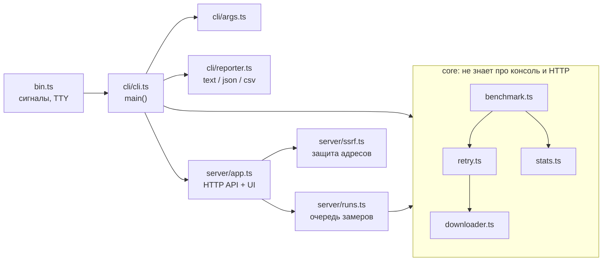

# speed-0-meter

[](https://github.com/Hharold42/speed-0-meter/actions/workflows/ci.yml)

Замер скорости скачивания на Node.js и TypeScript. Приложение работает в двух режимах:

- **консольный** (основное задание): принимает адрес, делает 10 последовательных запросов, дожидается полного ответа на каждый и печатает среднее время запроса, объём и скорость;
- **серверный** (`serve`): тот же замер через HTTP API и веб-интерфейс с очередью, историей и защитой от SSRF.

В рантайме внешних зависимостей нет. TypeScript, ESLint и Prettier нужны только для разработки.

## Быстрый старт

Нужен Node.js 22 или новее.

```bash
npm install
npm run build

# 1. Консольный режим
node dist/bin.js https://proof.ovh.net/files/10Mb.dat

# 2. Демо без интернета (встроенный локальный сервер)
node dist/bin.js --self-test

# 3. Серверный режим: веб-интерфейс на http://127.0.0.1:3000
node dist/bin.js serve
```

Команду `speed-0-meter` можно установить глобально из каталога проекта: `npm install -g .`.

То же в Docker, без установки Node.js:

```bash
docker build -t speed-0-meter .
docker run --rm speed-0-meter https://proof.ovh.net/files/10Mb.dat   # консоль
docker run --rm speed-0-meter --self-test                            # демо
docker compose up --build                                            # сервер на :3000
```

## Консольный режим

```bash
node dist/bin.js <url> [параметры]
```

| Параметр               | Описание                                                                | По умолчанию |
| ---------------------- | ----------------------------------------------------------------------- | ------------ |
| `-n`, `--requests <N>` | число запросов                                                          | `10`         |
| `-t`, `--timeout <с>`  | таймаут одного запроса, секунды                                         | `60`         |
| `-u`, `--unit <ед.>`   | единица скорости: `mbit` (Мбит/с) или `mbyte` (МБ/с)                    | `mbit`       |
| `-r`, `--retries <N>`  | повторы при временных ошибках (429, 5xx, сеть, таймаут)                 | `0`          |
| `-w`, `--warmup`       | прогревочный запрос, который не входит в статистику                     | выкл.        |
| `--min-speed <X>`      | порог скорости в выбранных единицах. Если скорость ниже, код выхода `3` | нет          |
| `--json`               | итог в JSON                                                             | выкл.        |
| `--csv`                | результаты запросов в CSV                                               | выкл.        |
| `--no-color`           | отключить цвета (также учитывается `NO_COLOR`)                          |              |
| `--self-test`          | демо на встроенном локальном сервере вместо адреса                      |              |
| `-h`, `--help`         | справка                                                                 |              |

Значения по умолчанию можно задать переменными окружения: `SPEEDTEST_REQUESTS`, `SPEEDTEST_TIMEOUT`, `SPEEDTEST_UNIT`, `SPEEDTEST_RETRIES`.

В терминале во время загрузки рисуется строка прогресса со скоростью (в stderr, поэтому пайпы и `--json` не портятся). `Ctrl+C` прерывает прогон, и итог по уже выполненным запросам всё равно печатается.

### Пример вывода

```
Адрес: http://127.0.0.1:56888/  (встроенный тестовый сервер)
Запросов: 5 (последовательно), прогрев

Прогрев: 0.596 с (в статистику не входит)
[1/5]   0.604 с  TTFB 0.003 с     8.00 МБ
[2/5]   0.618 с  TTFB 0.002 с     8.00 МБ
[3/5]   0.623 с  TTFB 0.017 с     8.00 МБ
[4/5]   0.682 с  TTFB 0.017 с     8.00 МБ
[5/5]   0.663 с  TTFB 0.017 с     8.00 МБ

--- Итог ---
Успешных запросов:     5 из 5
Среднее время запроса: 0.638 с
Медиана / мин / макс:  0.623 / 0.604 / 0.682 с
p95 / σ:               0.682 / 0.033 с
Средний TTFB:          0.011 с
Скачано всего:         40.00 МБ
Скорость скачивания:   100.31 Мбит/с
Скорость без TTFB:     102.06 Мбит/с
Время запросов:        ▁▂▃█▆
Порог 50 Мбит/с:       выполнен
```

### Коды выхода

| Код | Значение                                              |
| --- | ----------------------------------------------------- |
| `0` | все запросы успешны                                   |
| `1` | неверные аргументы или не получено ни одного ответа   |
| `2` | часть запросов завершилась ошибкой или прогон прерван |
| `3` | скорость ниже `--min-speed` (приоритетнее кода `2`)   |

Код `3` позволяет использовать утилиту как проверку в CI или мониторинге:

```bash
speed-0-meter https://cdn.example.com/big.bin -n 5 --min-speed 100 || echo "канал просел"
```

## Единицы измерения и формулы

- **Время**: секунды (`с`).
- **Объём**: мегабайты (`МБ`), 1 МБ = 1 000 000 байт (десятичные, как в тарифах провайдеров).
- **Скорость**: **мегабиты в секунду (`Мбит/с`)**. Это привычная единица для интернет-тарифов. Через `--unit mbyte` её можно получить в `МБ/с`.

```
среднее время = сумма времён успешных запросов / число успешных запросов
скорость      = суммарный объём / суммарное время запросов
Мбит/с        = (байт × 8) / секунд / 1 000 000
```

Время запроса считается от отправки запроса до получения последнего байта тела. Оно включает DNS, TCP/TLS-рукопожатие и ожидание ответа сервера (**TTFB**, время до первого байта). Поэтому основная скорость получается «честной» для пользователя. На маленьких файлах она будет заметно ниже канальной.

Для сравнения выводится и **скорость без TTFB**: объём делится на время одной передачи тела, без ожидания ответа. Паузы между повторами и время проверки адреса в серверном режиме в замер не входят.

Перцентиль p95 считается методом ближайшего ранга, σ — выборочное стандартное отклонение.

## Серверный режим

```bash
node dist/bin.js serve [--port 3000] [--host 127.0.0.1] [--token <строка>] [--max-concurrent 1] [--max-requests 20] [--max-queue 20]
```

Веб-интерфейс открывается по адресу сервера: форма запуска, прогресс, статистика, график времени запросов, таблица и история замеров.

### API

| Метод и путь           | Описание                                                                |
| ---------------------- | ----------------------------------------------------------------------- |
| `POST /api/runs`       | поставить замер в очередь. Ответ `202` и заголовок `Location`           |
| `GET /api/runs`        | список последних замеров (без подробных результатов)                    |
| `GET /api/runs/:id`    | состояние замера: статус, прогресс, промежуточная и итоговая статистика |
| `DELETE /api/runs/:id` | отменить замер из очереди или остановить выполняющийся                  |
| `GET /health`          | проверка живости, без авторизации                                       |

Тело `POST /api/runs`:

```json
{
  "url": "https://proof.ovh.net/files/10Mb.dat",
  "requests": 10,
  "timeout": 30,
  "warmup": false,
  "retries": 0
}
```

Обязателен только `url`. Статусы замера: `queued`, `running`, `done`, `failed`, `cancelled`.

```bash
curl -X POST localhost:3000/api/runs -H 'Content-Type: application/json' \
  -d '{"url":"https://proof.ovh.net/files/10Mb.dat","requests":3}'
curl localhost:3000/api/runs/<id>
```

Коды ошибок: `400` (неверные данные или запрещённый адрес), `401` (нет токена), `404`, `405`, `409` (замер уже завершён), `413` (слишком большое тело), `429` (очередь переполнена, есть `Retry-After`).

### Очередь и параллельность

Замеры идут **по одному** (`--max-concurrent 1`): параллельные замеры делят один канал и искажают результаты друг друга. Остальные ждут в очереди ограниченной длины (`--max-queue`). Очередь хранится в памяти, после перезапуска сервера история теряется.

### Безопасность

Сервер ходит по адресам, которые присылает пользователь, поэтому главный риск — **SSRF**. Что сделано:

- адреса, которые разрешаются во внутренние сети (`127.0.0.0/8`, `10/8`, `172.16/12`, `192.168/16`, `169.254/16` вместе с метаданными облака, `fc00::/7`, IPv4-in-IPv6 и другие), отклоняются; проверка идёт и перед каждым **редиректом** (редиректы обрабатываются вручную);
- ограничены число запросов в замере, таймаут, число повторов, размер тела запроса и длина очереди;
- опциональный Bearer-токен (`--token` или `SPEEDTEST_TOKEN`, сравнение за постоянное время). Токен лучше задавать переменной окружения, чтобы он не попадал в список процессов;
- по умолчанию сервер слушает только `127.0.0.1`. При запуске на другом интерфейсе без токена выводится предупреждение;
- заголовки `Content-Security-Policy`, `X-Content-Type-Options` и другие; в веб-интерфейсе нет inline-скриптов и стилей, данные выводятся через `textContent`;
- `--allow-private` отключает защиту, он нужен только для разработки.

**Ограничение:** между проверкой адреса и самим соединением возможна подмена DNS-ответа (DNS rebinding). Полностью это закрывает сетевой фильтр исходящего трафика на уровне контейнера или хоста (например, запрет доступа из контейнера к приватным подсетям). Для публичного развёртывания его нужно добавить.

### Docker

```bash
docker compose up --build                       # http://localhost:3000
SPEEDTEST_TOKEN=secret docker compose up        # с токеном для API
docker run -p 3000:3000 speed-0-meter serve --host 0.0.0.0
```

Образ двухэтапный: TypeScript компилируется в первом этапе, в итоговый попадают только `dist/` и `public/`. Процесс работает не от root; в `docker-compose.yml` включены `read_only`, `cap_drop: ALL` и healthcheck. Скорость измеряется **из контейнера**: в Docker Desktop трафик идёт через виртуальную сеть, поэтому цифры могут слегка отличаться от запуска напрямую.

## Архитектура



Ядро замера (`src/core`) не зависит ни от консоли, ни от HTTP-сервера, поэтому один и тот же код работает в обоих режимах.

### Принятые решения

- **Глобальный `fetch`, без зависимостей.** Достаточно для задачи, а образ и поверхность атаки минимальны.
- **Строго последовательные запросы.** Так требует задание, и так же честнее для измерения канала.
- **`Accept-Encoding: identity`.** Сжатие исказило бы объём и скорость.
- **Редиректы вручную.** Нужно, чтобы проверять каждый переход защитой от SSRF и ограничивать их число.
- **Ошибка запроса не прерывает прогон.** Она помечается в выводе и не влияет на среднее и скорость.
- **Проверка `Content-Length`.** Обрезанный ответ считается ошибкой, а не даёт «красивую» скорость.
- **Очередь в памяти.** Для одного сервера этого достаточно; замеры идут по одному, чтобы не искажать друг друга.
- **TypeScript 6.0.** `typescript-eslint` пока не поддерживает TypeScript 7.

## Разработка

```bash
npm run build           # компиляция src/ -> dist/
npm run lint            # ESLint
npm run format:check    # Prettier (исправить: npm run format)
npm run typecheck       # проверка типов без сборки
npm test                # сборка и тесты (node:test, локальные серверы, интернет не нужен)
npm run test:coverage   # то же с отчётом о покрытии
```

CI (`.github/workflows/ci.yml`) запускает линтер, форматирование, типы и тесты на Node.js 22 и 24, а также собирает Docker-образ и проверяет оба режима. По тегу `vX.Y.Z` (`release.yml`) публикуется образ в GHCR и создаётся GitHub Release. Публикация в npm включается переменной репозитория `PUBLISH_NPM=true` и секретом `NPM_TOKEN`. Участие в разработке описано в [CONTRIBUTING.md](CONTRIBUTING.md).

## Идеи по улучшению

- Постоянное хранилище (SQLite или Postgres): история замеров и график динамики за период.
- Периодические замеры по расписанию, экспорт метрик в Prometheus (`/metrics`), оповещения при падении скорости.
- Параллельный режим `--concurrency` для проверки полной ширины канала.
- Защита от DNS rebinding: проверка адреса в момент соединения через собственный резолвер (`undici` с `connect.lookup`).
- Server-Sent Events вместо опроса в веб-интерфейсе.
- Замер скорости на стороне браузера: сервер только отдаёт тестовые файлы.
- Тесты веб-интерфейса (Playwright), мутационное тестирование.
- Автоматический changelog, публикация в npm, подписанные образы.
